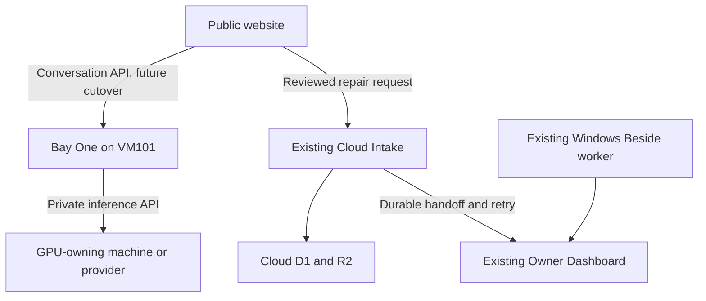

# Bay One → VM101: source recovery, staging, and cutover gates

**Audit date:** 2026-10-17. **Public source baseline:** `11081000f5f4b13511918a3f33efef5c73398246`.

## Decision and implemented scope

Use the existing Ubuntu VM101 as the intended permanent Bay One compute destination, while retaining the independently hosted Cloud Intake as the durable website-request boundary. First qualify the existing Node reference runtime with synthetic data on VM101. Port the actual hosted conversation service only after obtaining its exact source and data contract. Preserve the current Owner Dashboard and Windows Beside worker during this phase.

The [deployment package](../deploy/vm101/README.md) implements a dedicated systemd service, loopback-only API/inbox, isolated SQLite state, disabled external integrations, optional private Ollama inference, verified release installation and a local checkpoint/restore helper. It does not change production routing or implement the separately tracked hosted pricing-quota correction.

The October 16 reply generated by Bay One on behalf of Tony is architectural context, not independent evidence that Tony personally reviewed or approved an architecture. This work follows the owner's migration instruction and the verified sources below.

## Existing production, independently inspected

| Component | Verified revision/configuration | State and limit of evidence |
| --- | --- | --- |
| Static website | Main `11081000f5f4b13511918a3f33efef5c73398246`; Node 24 build/test tooling | Fresh main checkout and live configuration GETs agree |
| Public AI endpoint | `https://bay-one-website-assistant.ubnvs1.chatgpt.site` | Live health 200; `chat: ready`, `roughEstimates: true`, `intake: false`, `modelStatus: configured_unverified`, media unavailable. A health response does not verify a real model answer or current quota behavior |
| Hosted Bay One source/history | October 12 restoration describes DeepSeek plus D1 conversation/quota storage | Actual current hosted project, deployed source revision, bindings, secrets and conversation export are unavailable in the connected editable Sites inventory |
| Cloud Intake | Saved version 9, source `a0fecdfba5a91be05f5f8cc343ce836de6ea3f2a` | Current source recovered unchanged; deployment status succeeded; health 200, cloud storage and media ready |
| Owner Dashboard | Saved version 20, source `369b4534f2eccad746aca5b84ff896145178305f` | Current private source recovered unchanged; deployment status succeeded; live table names inspected |
| Windows dashboard/Beside worker | Current main records one-minute task activation and successful reconciliation/fresh Beside readback | Source-recorded operational evidence; the Windows task was not independently executed again in this audit |
| VM101 | Previously reported Ubuntu 24.04.5, 2 vCPU, 1 GiB RAM, 32 GiB disk, SSH/QEMU agent and autostart | Reported inventory only. The remote device listed online, but its first read-only process call hung without a PID or result; guest configuration was not freshly verified |

Production deployment receipts recovered through Sites:

- Cloud Intake: project `appgprj_6ac0bd5aa77481918cc6a603a3251492`, version `appgprj_6ac0bd5aa77481918cc6a603a3251492~appgver_98bb6caf71ac819192594677ab9404ef`, deployment `appgdep_6acdb9ad3be88191b1f145a660c4c223`.
- Owner Dashboard: project `appgprj_6abc24ce151881919044d4d19d7bf303`, version `appgprj_6abc24ce151881919044d4d19d7bf303~appgver_8ddf614dc2f8819192d2be079cb0d08c`, deployment `appgdep_6ad1724b460081919f023d0c10554079`.

These identifiers are deployment receipts, not credentials. Private source, environment values, customer rows and exports must remain outside this public repository.

### Current request paths

[`bay-one-config.js`](../bay-one-config.js) routes conversation traffic to hosted Bay One. [`contact-config.js`](../contact-config.js) routes repair submissions to `https://perfect-timing-cloud-intake.prudhvi-pallempati.chatgpt.site`. The reviewed handoff in [`bay-one-widget.js`](../bay-one-widget.js) uses the contact endpoint for `/hooks/lead/webform`, preserving its pending retry key. A conversation alone is not a submitted inquiry.

The hosted October 12 restoration does not depend on the original laptop remaining online. The Windows desktop `Bay One.exe` and the unavailable private `fixingfortmyers-jpg/bay-one` repository have not been established as the current hosted service's source.

The routes and successful health checks establish intended routing and current basic availability. They do not establish end-to-end delivery of every channel into a shared authoritative store.

## Runtime and storage comparison

| Component | Dependencies and durable state | VM101 suitability |
| --- | --- | --- |
| Public Node reference service | Node 24, built-in `node:sqlite`, SQLite lead and chat databases, media files, chat signing key. Existing code includes DeepSeek and native Ollama adapters | Suitable for isolated API qualification. Production conversation parity and historical import are unverified |
| Hosted Bay One | Restoration documents DeepSeek and D1; actual current source/runtime is inaccessible | Intended later destination is VM101. Do not substitute the reference schema or Windows executable without a source comparison |
| Current Cloud Intake | Worker ESM with `nodejs_compat`, generated compatibility date `2026-09-01`; `DB` D1 and `MEDIA` R2. Drizzle ORM 0.45.2 / kit 0.31.10 are development dependencies | Keep hosted initially. A Linux process cannot receive managed D1/R2 bindings merely by copying source |
| Current Owner Dashboard | Node >=22.13; Next 16.3.4, React 19.2.6, Vinext 1.0.0-beta.5, Vite 8.0.13, Wrangler 4.92.0; D1 `DB`; Sites authentication/build integration | Can be ported with an explicit runtime, database and authentication adaptation. A plain `next start` substitution would not preserve the verified deployed contract |
| Dashboard synchronization | Python standard-library pieces plus Windows-only launcher/capture, private import helpers, configuration, archives and checkpoints | Some pure synchronization functions are portable; complete current Beside acquisition is not a headless Ubuntu service |
| AI inference | DeepSeek provider or separately qualified local model. Ollama adapter uses native `/api/chat`; other protocols require adaptation | Keep model execution off the reported 1 GiB guest. Use the GPU-owning machine's private API; verify GPU, model, memory, latency and availability first |

Current Cloud D1 tables: `leads`, `files`, `handoff`, `owner_alerts`, `metrics`, `rate_limits`, `analytics_events`. Current Owner tables: `inquiries`, `activity`, `sources`, `seo_snapshots`, `beside_refresh_queue`. A source migration journal does not establish the live applied migration journal.

The current managed environment exposes binding/key names, but masked secret values are not readable export material and are not evidence that the secrets are absent. Cloud configuration includes Owner URL/tokens, private API token and media signing secret. Owner includes its allowed-account list, sync token and Google-related settings. Preserve these through authorized secret provisioning; do not copy them into this repository or a browser bundle.

Cloudflare's [D1 binding API](https://developers.cloudflare.com/d1/worker-api/d1-database/) supplies `env.DB` and transactional SQL batches. Local emulation is useful for tests, not evidence that a Linux deployment preserves managed D1 operations. A production port must deliberately retain a supported remote database access layer or implement and qualify a replacement transaction/storage adapter. R2 objects and signed media URLs require a corresponding object-storage/access design.

## Why keep the separate Cloud Intake

The recovered worker saves a normalized inquiry, pending handoff, owner-alert row and relevant metric/media metadata in one SQL batch before returning a saved receipt. It has no dependency on Bay One's model or VM101. Matching retry key and content return the original ID; changed content under the same key is rejected with 409.

Downstream handoff persists its mapping version and timestamp, claims work for 30 seconds, times out after 12 seconds, and requires `ok: true` plus `accepted: 1` to mark delivery. Retry delays begin at 15 seconds and cap at five minutes. The worker exposes a scheduled handler and authenticated recovery drain, but actual deployed scheduler execution remains to be read back.

Removing this service now would mean replacing its receipt boundary, atomic outbox, media handling, retry/recovery interfaces, metrics identity and Owner mapping. Moving all of those to the same Proxmox host would make host failure prevent new durable intake. A browser queue or a backup cannot acknowledge new submissions while the receiving server is down. An independent queue/receiver would still be necessary, so removal would not currently reduce total operational complexity.

Keep cloud ingress and storage independent of VM101, its tunnel, local power and local Internet. VM unavailability can then interrupt AI replies without interrupting the cloud submission path. The website must continue to distinguish a locally retained draft, an uncertain network response and a saved server receipt. Replay the same key and body after uncertainty; never declare success before durable acceptance.

For disaster recovery as well as continuity, preserve encrypted exports of Cloud D1, R2 objects and mappings; Owner D1 including notes/activity; and future VM conversation state plus signing identity. Choose storage and keys outside the Proxmox host, set retention and monitor backup age, then restore into a separate environment and read back identities. Cloudflare documents that a [D1 export can block database requests](https://developers.cloudflare.com/d1/best-practices/import-export-data/), so plan full production exports as an operational step. No full production export or backup validation was performed here.

## Preserve inquiry identity, history, and owner decisions

The actual Owner sync contract maps a website Cloud root `<uuid>` to `source=website`, `source_id=<uuid>`, and inquiry key `website:<uuid>`. Source upserts preserve owner `stage`, `notes`, `owner_updated_at`, `owner_updated_by` and activity. New source enrichment may update source fields under its version rules, but cannot redefine owner decisions.

Treat Cloud Intake as the accepted website-request record and Owner Dashboard as its operational projection plus owner decisions. Beside and other sources retain their own namespaced IDs. A universal customer identity or cross-channel deduplication system has not been demonstrated. Preserve source IDs and provenance; do not merge rows merely because names or phone numbers resemble one another.

The current Beside capture uses signed-in Windows Chrome UI Automation and private archive/import helpers. The one-minute Windows task and its readiness contract are part of the working system. Keep it running until an equivalent acquisition path is implemented and independently reconciled. Preserve its authority flags, source checkpoints, archives, refresh leases and readback receipts; do not enable a second acquisition scheduler on VM101.

Conversation migration requires the actual hosted D1 schema, retained rows, visitor/session ID format, signing/verification keys, timestamps, request IDs and cached replies. The October 12 documentation describes six recent exchanges and cleanup of histories older than seven days on later traffic. The reference Node service uses different context handling and performs cleanup at startup. An export cannot recover records already pruned. Preserve the original export before any cleanup and decide on retention explicitly; never test a migration against the only copy.

## Pricing and booking coordination

The reference conversational pricing changes are already tracked by merged PRs [#75](https://github.com/Palle017/fixingfortmyers-site/pull/75) and [#76](https://github.com/Palle017/fixingfortmyers-site/pull/76) and [BAYONE-UNIFIED-RELEASE-2026-10-16.md](BAYONE-UNIFIED-RELEASE-2026-10-16.md). This staging wrapper reuses that code unchanged. It does not implement a competing hosted quota fix. The reference session has no customer estimate quota; preliminary ranges require sufficient vehicle/repair facts and retain the existing disclaimers. Model failure must not fabricate a quote, saved inquiry or booking.

Preserve the existing 24/7 request picker, acknowledgment, single form and **penciled in → call Tony → verbally confirmed** contract. Current live source and table inspection do not show the staged calendar writer/confirmation implementation deployed. Continue that work through [issue #67](https://github.com/Palle017/fixingfortmyers-site/issues/67) and its canonical runbook, without changing the customer journey.

**New prerequisite discovered:** the current Cloud source already has `0002_violet_rawhide_kid.sql` (analytics) and `0003_funny_scorpion.sql` (handoff mapping version/time). The older staged booking work names different migrations `0002_medical_blindfold.sql` and `0003_puzzling_carmella_unuscione.sql`. Inspect the actual production journal and regenerate additive booking migrations on the current source; do not apply the old numbering blindly. Reconcile the staged Owner confirmation components into current `369b453`, preserving the newer Beside refresh and reconciliation work.

The existing booking source receipts identify Cloud staged `ccbfa1b` and Owner staged `48986dc` on the Windows machine. They were not freshly inspected through the blocked remote command path in this audit. No new Codex job was launched, and no current Codex task inventory was available; coordination uses the shared GitHub sources, merged changes, issue and runbook.

## Failure verification completed locally

| Failure | Isolated evidence | What is still unverified |
| --- | --- | --- |
| Model unavailable | Node returned truthful scripted help, no estimate/appointment, then accepted a separately reviewed synthetic inquiry | Actual hosted provider outage and candidate local-model quality |
| VM/application unavailable | Node process termination made its API unavailable; actual Cloud code accepted durable intake with its downstream consumer failing and no VM/model dependency | Guest power loss, external tunnel behavior, real customer routing during outage |
| Interrupted submission | Partial body created no inquiry; lost reply after commit retried to the original receipt | Live mobile/browser network failure against the actual hosting stack |
| Duplicate and conflicting retries | Node concurrent retries produced one row. Actual Cloud SQL: 20 identical requests yielded 1 create + 19 duplicates; mixed payloads yielded one winning root and conflicts | Distributed production D1 contention and real edge retries |
| Owner commit followed by lost acknowledgment | Actual Cloud/Owner contracts reused the same root and source version; notes, stage, owner actor/time and activity survived replay | Managed authentication, deployed scheduler and real private HTTP handoff |
| Restart/recovery | Abrupt Node process kill preserved receipt, status, chat signing identity and cached reply. Cloud pending work survived SQLite reopen and recovered after claim expiry | Physical disk/power loss and off-host restore on VM101 |
| Storage transaction fails | Lead/queue/alert/metric SQL rolled back together; no false success. Owner transaction failure left Cloud work pending for recovery | Actual storage exhaustion/failover and managed durability |
| Backup restore | Offline Node checkpoint verified hashes and SQLite integrity; separate restore preserved receipt and signing identity | Hosted D1/R2 export and independently stored disaster-recovery copy |

Results: **251/251 public Node tests**, including nine VM101 scenarios; **59/59 dashboard sync tests**; accessibility **zero violations**. Separately, recovered current private Cloud baseline **35/35** and actual-source Cloud/Owner failure harness **9/9** passed. The private harness imports the pinned recovered source, uses native SQLite behind a minimal D1 adapter and mocked transport/R2, verifies source hashes, and performs no production network calls. It is kept outside this public repository.

The SQL tests do not make R2 and D1 a joint transaction. Existing media behavior can leave an orphaned R2 object after a later SQL failure; uncertain attachment metadata remains `needs_review`. Preserve objects and root mappings and retain media-specific recovery tests.

## Proposed production destination, after remaining gates

The first arrow is proposed; production conversations still use hosted Bay One. The public conversation endpoint will require a verified HTTPS ingress/tunnel, correct trusted-origin configuration, rate limits, request size/timeouts and monitoring. Keep the private inbox off that ingress. Preserve the hosted endpoint for rollback and avoid concurrent writers to incompatible conversation stores.

### Implementation-ready continuation, in order

1. Restore a working remote execution route to the online Windows device or an authorized direct SSH route to VM101. The observed blocker was a hung remote process call without a PID/result, not a verified SSH, credential or VM failure. Freshly verify the guest and install the isolated package with the supplied Node 24 binary.
2. Recover the actual hosted Bay One project through its owning account or obtain a version-matched private source/export packet. Include lockfile, runtime entrypoint/build, environment variable names and secure provisioning path, D1 schema and applied migrations, history/export metadata, signing identity, current pricing policy and recent deployment receipt. A desktop executable or a public endpoint URL is insufficient.
3. Compare hosted HTTP/session/history behavior against the reference runtime. Implement only the necessary adapters in an appropriate private source repository. Import into a new database; reconcile counts, hashes, IDs and time ranges; disable destructive cleanup during the migration check. Preserve the existing hosted quota correction as its own coordinated work item.
4. Preserve current Cloud/Owner storage and keep their production routes active. Verify an independent backup/restore, applied migration journals, private authorization, scheduled drain execution, pending-work age and a cross-service inquiry readback. Reconcile booking migrations against the recovered revisions before any calendar activation.
5. Qualify the chosen inference backend using synthetic repair conversations, structured estimates and outage cases. Establish a private authenticated network route to the physical GPU host if used. No remote PCI passthrough is assumed or attempted.
6. Run guest-specific restart/storage tests and an explicitly controlled end-to-end submission/readback. Trace one approved synthetic root through Cloud receipt, Owner `website:<id>`, any Bay One review handoff and the relevant Beside lineage without asserting they are a shared database. Booking proof additionally requires real provider credentials and authorized tentative event readback under the locked contract.
7. Only after those gates, change the conversation route, observe error/latency/receipt and pending-work metrics, and preserve a tested rollback to the hosted conversation endpoint. Do not change the independent repair-intake endpoint as a side effect. Keep source rollback separate from data rollback and replay accepted records rather than dropping them.

No production POST, customer notification, calendar write, managed deployment change, DNS change, VM installation or cutover was performed in this audit. Public endpoint configuration remains unchanged. The next dependencies are specific technical access and data-contract verification, not a request to reapprove the already instructed migration.
